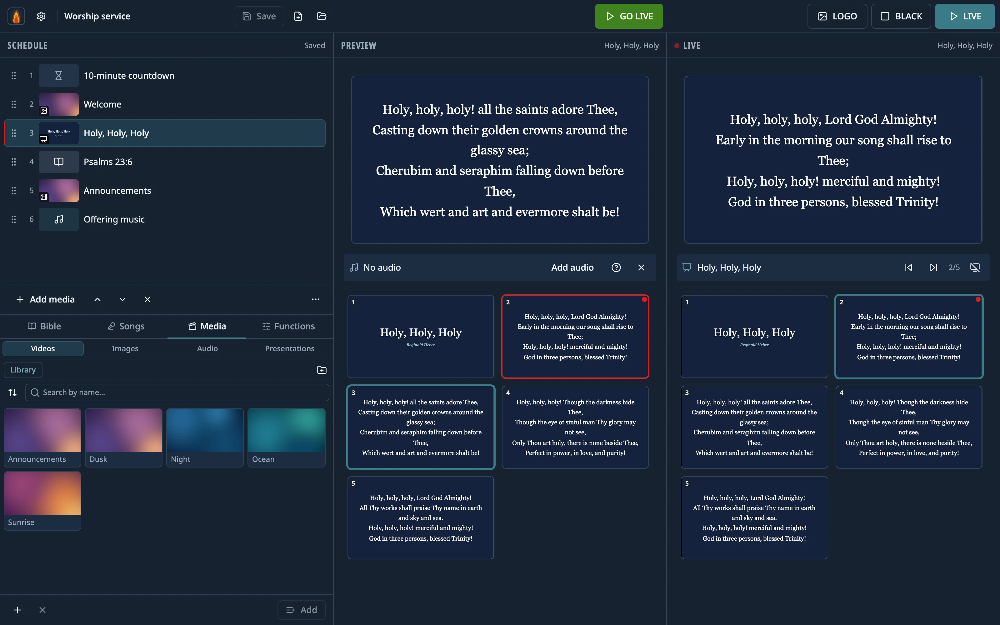

# Lumina Live

**Free and open-source church presentation software.** Slides, video, images, audio, the Bible and
timers on a second screen, with the same two-step flow as EasyWorship: pick it, check the preview,
and only then send it LIVE.

**[Website](https://lumina-live-site.vercel.app/)** · **[Download](https://github.com/NicolasAmorosi/lumina-live/releases/latest)** ·
Windows, macOS and Linux · English, Spanish, Italian and Portuguese



## Features

- **Presentations** in `.ppt`, `.pptx`, `.pps`, `.ppsx`, `.odp` and `.pdf`, read and drawn by Lumina
  itself — nothing else to install —, including `.pps` hymnals with auto-advance and music: each
  slide's timing and the embedded audio are kept.
- **Any video or audio.** Whatever the player can't decode (AVI, WMV, ProRes, AC3…) plays at once
  through Lumina's own media engine, built on libmpv. Nothing is converted and the original file is
  never touched.
- **Bible** with full-text search (accent-insensitive), favourite passages and the ones that went live
  recently. Ships with the Reina-Valera 1909; import other versions in JSON, Zefania, USFX, OSIS or
  MyBible/MySword modules.
- **Songs:** type or paste the lyrics — with headers like `[Verse 1]` or `[Chorus]` in English, Spanish,
  Italian or Portuguese, or none, and the block that repeats becomes the chorus — and the app builds the
  slides. One order per song, as chips you drag or a line like `V1 C V2 C B C`. **Every slide of a song is
  drawn at the same size**: the largest at which all of them fit. Search by title, number, author or a
  word of the lyrics (accent-insensitive). Live, the keys jump to a section (1–9 a verse, C the chorus,
  P the bridge, F the ending; Shift the previous time) and T hides the lyrics. Named themes (background,
  font, sizes, colours, outline, margins, lines per slide, a copyright footer with your church's CCLI
  licence, a fade between slides, a looping video behind the lyrics). **Two languages at once:** a
  translation under the lyrics, and live you switch between the original, both or the translation.
  Import from **EasyWorship 6**'s song database (version 7 should read the same; not yet tested with
  one), **OpenLP**'s `songs.sqlite`, **OpenLyrics** files (a second language comes in as the
  translation), **SongSelect** lyrics (`.txt`) and **ChordPro** files. A CCLI usage report: what went
  live, once a day, as a CSV.
- **A look to start with:** eight backgrounds and four moving ones in the library, song themes over
  them, a quiet background behind the verse, dressed timers and three overlays ready to fill in — all
  editable, and none of it touches what you already changed.
- **A stage screen** for the musicians on a third screen: what is live, what comes next and the time.
- **Timers** (countdown, clock, stopwatch) and **overlays** on top of what is projected (a lower third
  with the preacher's name, the church logo).
- **BLACK and LOGO** pause whatever is playing and resume it where it was.
- **Built for a live service:** if the projector disconnects, the picture comes back by itself when
  it reconnects; the schedule saves itself; closing the app by accident asks first.
- Saved programs, a media library, light and dark themes.
- **In English, Spanish, Italian and Portuguese.** The first launch follows the computer's language;
  change it in Settings › System.

## Download

Installers are on [Releases](https://github.com/NicolasAmorosi/lumina-live/releases/latest): Windows
(installer), macOS on Apple Silicon (`.dmg`) and Linux: a `.deb` for Ubuntu, Debian and Linux Mint,
and an `AppImage` for other distributions. On Ubuntu 24.04 or later use the `.deb`: AppArmor won't
let the AppImage start without `--no-sandbox`, which turns off a security protection. On Linux the
files Lumina's media engine plays (AVI, WMV, WMA…) need the distribution's libmpv: the `.deb` installs
it, and with the AppImage install `libmpv2` (`libmpv1` on Ubuntu 22.04) and `libopengl0`.

- The installers **aren't signed yet**. On Windows: «More info» → «Run anyway». On macOS: System
  Settings → Privacy & Security → «Open Anyway».

## Updates

Lumina Live updates itself from the app. Versions up to 2.2.0-beta.5 can't: download the new one
from Releases once, and from then on it can.

- **Checking.** About 10 seconds after it opens, the app asks GitHub whether this repository's
  release marked *Latest* is newer than the installed version. That is the only connection it makes
  on its own; it sends nothing about you or your church, and there is no telemetry. Turn it off in
  Settings › About › «Check when the app opens», or check by hand with «Check for updates».
- **Downloading** (about 200 MB) only starts when you press «Download», so it never competes with
  a livestream for the network. Before anything is installed, the file is checked against the
  sha512 published with the release.
- **Installing.** Choose «Restart and update» or «When the app closes». If something is on the
  projector or the schedule isn't saved, restarting asks first, exactly like closing the app. A
  notice appears in the control window when a new version is found, once per version; nothing about
  updates ever shows on the projector.
- **Windows** installs silently, and «Restart and update» opens the app again afterwards. If it was
  installed for all users, Windows asks for permission first.
- **macOS:** without a paid Apple signature, macOS doesn't let an app replace itself. Lumina Live
  downloads and checks the `.dmg` and opens it: drag Lumina Live to Applications and choose
  «Replace». Your programs, library and settings stay as they are.
- **Linux:** the AppImage replaces itself; the `.deb` asks for your password to
  install.

## Development

Requires Node.js 22 or later.

```bash
npm install          # also downloads Electron, FFmpeg and the media engine for your platform
npm run dev          # the app with hot reload
npm run typecheck && npm run lint && npm run test   # the minimum before a PR
npm run test:e2e     # end-to-end runs of the real app with Playwright
npm run package:win  # or package:mac / package:linux
```

Before touching code, read [`CLAUDE.md`](CLAUDE.md): it is the project's architecture and conventions
guide, and [`docs/knowledge/`](docs/knowledge/) has the detail of each layer. To contribute, see
[`CONTRIBUTING.md`](CONTRIBUTING.md).

Stack: Electron, TypeScript, React, Vite, Tailwind, Zustand and SQLite (`better-sqlite3` + Drizzle).

## License

[GPL-3.0-or-later](LICENSE). You can use, study, modify and share it; if you distribute a modified
version, it has to stay free under the same license.

FFmpeg ships alongside the app as a separate program, under its own GPL-3.0 license (see
[`resources/ffmpeg-NOTICE.txt`](resources/ffmpeg-NOTICE.txt)), and so does the media engine with its
libmpv (see [`resources/engine-NOTICE.txt`](resources/engine-NOTICE.txt); the engine's source is in
[`native/`](native/)). The shapes of legacy `.ppt` files are drawn from LibreOffice's
table of Office's shapes, under the MPL-2.0 (see
[`resources/ooxml/mso-shapes-NOTICE.txt`](resources/ooxml/mso-shapes-NOTICE.txt)). The text of the Reina-Valera 1909 is in the public domain.
